<!-- Camada 1: Hero SVG Animado com Maquina de Escrever Dinamica (Dark & Light) -->
<picture>
  <source media="(prefers-color-scheme: dark)" srcset="./hero_banner.svg" />
  <source media="(prefers-color-scheme: light)" srcset="./hero_banner_light.svg" />
  
</picture>

  

<!-- Camada 2: Contato Rapido & Conversao -->

&nbsp;

&nbsp;

---

### 🎯 Sobre Mim

Profissional de tecnologia com **mais de 10 anos de experiência sólida em sustentação de sistemas, infraestrutura corporativa e suporte técnico avançado** (atuação remota internacional, ambientes VoIP/SIP, troubleshooting crítico e análise de causa-raiz em produção).

Em transição ativa e aplicação contínua em **Desenvolvimento Web / Full Stack Júnior e Automações com IA**. Uno a disciplina operacional e a maturidade de quem conhece a rotina de produção à agilidade de desenvolvimento com TypeScript, React, Next.js, Python, bancos relacionais/edge e processamento audiovisual.

---

### 🚀 Repositórios em Destaque

* 🤖 **[Systems & Solutions Specialist (SupportKit)](https://github.com/Smizmaul-ti/systems-solutions-specialist-v1)**  
  *Ambiente portátil e CLI para sustentação corporativa, suporte N1/N2/N3, troubleshooting crítico e automação operacional.*  
  **Stack & Engenharia:** `Python` • `CLI Tooling (supportkit)` • `Análise RCA & ITSM` • `Redes, VoIP/SIP & Linux` • `Runbooks Automatizados`  
  **Impacto:** Padroniza rotinas de diagnóstico de infraestrutura, investigação de incidentes em produção e execução de runbooks técnicos sem dependência de plataformas proprietárias.

* 🎙️ **[ShortDub](https://github.com/Smizmaul-ti/ShortDub)**  
  *Aplicação Full Stack para download de vídeos, transcrição automática e dublagem sincronizada multi-idioma com IA.*  
  **Stack & Engenharia:** `Python` • `TypeScript / Web Audio` • `Whisper ASR` • `Demucs v4 (Stems DSP)` • `Gemini LLM` • `FFmpeg`  
  **Impacto:** Pipeline autônomo para vídeos curtos (Shorts, Reels, TikTok) com isolamento da trilha sonora original, adaptação temporal isocrônica sem pitch drift e estúdio web dual-track.

* 🎯 **[Leads MVP](https://github.com/Smizmaul-ti/Leads-MVP)**  
  *Sistema Full Stack de inteligência de mercado B2B para descoberta, enriquecimento cadastral e qualificação de empresas.*  
  **Stack & Engenharia:** `Python` • `TypeScript & React` • `Cloudflare D1 / Workers Edge` • `APIs & Data Grid`  
  **Impacto:** Substitui a prospecção fria manual por um motor analítico que diferencia ausência de dados de validação negativa, gerando diagnósticos com fontes públicas rastreáveis e exportação CSV.

* 🛡️ **[CloudOps Hub](https://github.com/Smizmaul-ti/cloudops-ai-hub)**  
  *Plataforma para governança operacional, gestão de incidentes de TI e monitoramento de estabilidade.*  
  **Stack & Engenharia:** `TypeScript` • `Next.js` • `PostgreSQL` • `REST APIs` • `Observabilidade & Métricas`  
  **Impacto:** Centraliza a resposta a falhas críticas em produção, controle de SLAs de atendimento e fluxos estruturados de RCA (Root Cause Analysis).

---

### 📊 Telemetria de Código & Histórico de Produção

<!-- Cobrinha dos Commits (Dark & Light) -->
<picture>
  <source media="(prefers-color-scheme: dark)" srcset="./github-contribution-grid-snake-dark.svg" />
  <source media="(prefers-color-scheme: light)" srcset="./github-contribution-grid-snake-light.svg" />
  
</picture>

  

<!-- Dashboard Isometrico 3D sincronizado com os 1.196 commits via METRICS_TOKEN -->

