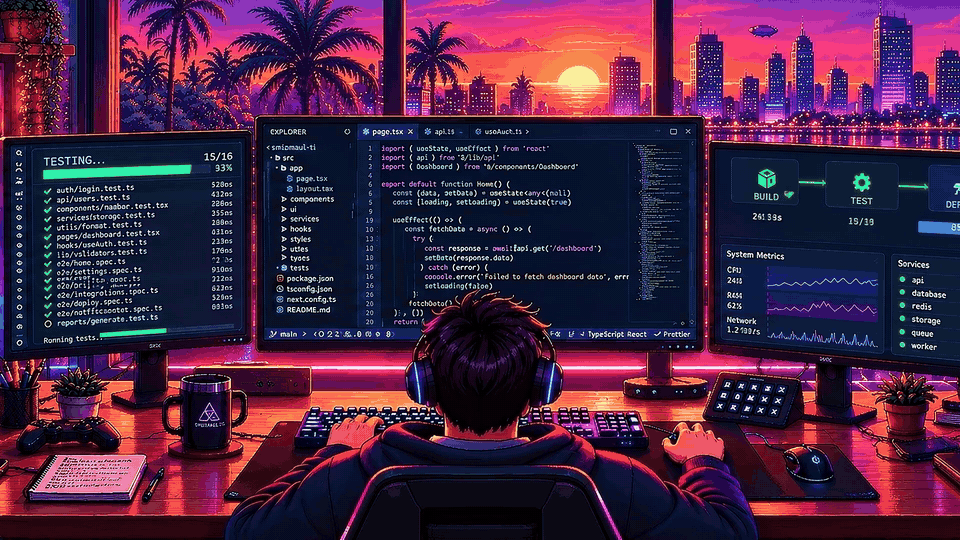

<!-- Camada 1: Hero SVG Animado com Maquina de Escrever Dinamica (Dark & Light) -->
<picture>
  <source media="(prefers-color-scheme: dark)" srcset="./hero_banner.svg" />
  <source media="(prefers-color-scheme: light)" srcset="./hero_banner_light.svg" />
  
</picture>

  

<!-- Camada 2: Contato Rapido & Conversao -->

&nbsp;

&nbsp;

---

### 🎯 Sobre Mim

Profissional de Tecnologia da Informação com mais de 10 anos de experiência em sustentação de sistemas corporativos, infraestrutura de redes e suporte técnico N2/N3, incluindo operações B2B internacionais e ambientes VoIP/SIP. Experiência em diagnóstico e resolução de incidentes críticos em produção, troubleshooting avançado e análise de causa raiz (RCA).

Atualmente, amplio minha atuação em Engenharia de Software, com foco em desenvolvimento Full Stack, integração de sistemas via APIs REST e automações com Inteligência Artificial. Trabalho com JavaScript/TypeScript, React, Next.js, Python, SQL, PostgreSQL e Cloudflare Edge, aplicando conhecimentos de infraestrutura e sustentação ao desenvolvimento de soluções web.

 

  

---

### 🚀 Projetos em Destaque

* 🤖 **[SupportKit (Systems Specialist)](https://github.com/Smizmaul-ti/systems-solutions-specialist-v1)** — Suite CLI em Python para padronização de diagnósticos de sistemas, runbooks operacionais, análise de causa-raiz (RCA) e sustentação N1/N2/N3.
* 🎙️ **[ShortDub](https://github.com/Smizmaul-ti/ShortDub)** — Pipeline Full Stack de áudio/vídeo em Python e Web Audio para download, transcrição (Whisper), tradução contextual e dublagem sincronizada (Demucs v4, Gemini, Edge TTS e FFmpeg).
* 🎯 **[Leads MVP](https://github.com/Smizmaul-ti/Leads-MVP)** — Aplicação de inteligência comercial B2B em React, TypeScript e Cloudflare D1/Workers para enriquecimento de dados e qualificação com fontes públicas auditáveis.
* 🛡️ **[CloudOps Hub](https://github.com/Smizmaul-ti/cloudops-ai-hub)** — Plataforma para governança de incidentes e sustentação com Next.js, ASP.NET Core (.NET/C#), PostgreSQL e Docker.

---

### 📊 Telemetria de Código & Histórico de Produção

<!-- Cobrinha dos Commits (Dark & Light) vinculada ao calendario oficial de contribuicoes -->
<picture>
  <source media="(prefers-color-scheme: dark)" srcset="./github-contribution-grid-snake-dark.svg" />
  <source media="(prefers-color-scheme: light)" srcset="./github-contribution-grid-snake-light.svg" />
  
</picture>

  

<!-- Distribuicao de Linguagens compilada pelo GitHub Linguist (Dark & Light) -->
<picture>
  <source media="(prefers-color-scheme: dark)" srcset="./github-metrics-dark.svg" />
  <source media="(prefers-color-scheme: light)" srcset="./github-metrics-light.svg" />
  
</picture>

---
